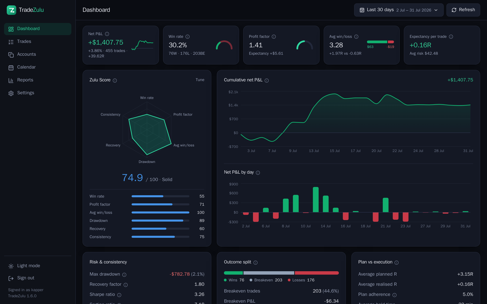

<div align="center">

# TradeZulu

**A trade copier and trading journal for MetaTrader 5 - in one!**

Copy trades across any number of accounts under your own risk rules,
and journal every one of them. Self-hosted, free, and yours.

</div>


More screenshots are in [docs/screenshots.md](docs/screenshots.md).

## Quick start

You need a Linux machine with Docker and the Compose plugin. Nothing else is
installed on the host.

```bash
git clone https://github.com/KasperSkytte/tradezulu.git
cd tradezulu
./install.sh --brokers vantage,falcon
```

That builds a MetaTrader terminal image for each [broker](brokers.json) you
name, generates your `.env` (printing the login it made), and starts the
stack. Open <http://localhost:8420>, sign in, add your account, and a terminal
container is started and logged in for it within a minute. Brokers without an
entry of their own use `default`, the generic MetaQuotes terminal.

Journal only, no copying or terminals:

```bash
./install.sh --no-terminals
```

Everything TradeZulu knows lives in one SQLite database in the
`tradezulu-data` Docker volume.

The admin user is created on the **first** start only, so editing those
variables later has no effect — change the password in Settings, or from
outside if you are locked out:

```bash
docker compose exec tradezulu set-password --username you --password 'a new one'
docker compose exec tradezulu list-users            # if you forgot the name
```

**Just want a look first?** This fills a throwaway database with example trades:

```bash
docker compose run --rm --service-ports -e TZ_DEMO=1 tradezulu demo
```

## Features

**Journal** — Track and improve your performance
 - Instantly synchronize trades from any MetaTrader5 account
 - See key statistics for a chosen time period, like win rate, profit factor, average R, your usual risk/position size distribution, etc
 - Track your overall performance by a combined "Zulu score" that includes 6 key metrics
 - Understand your mistakes, behavior, and setups by adding tags to individual trades alongside notes for each trade or trading session/day
 - Trade setup replay for each trade (KLineCharts or TradingView)
 - See detailed reports about which times of day, setups, tags, etc, that work the best for you, and what to stop doing
 - Did you follow your plan? See planned vs realised stats in R-multiples and percentages
 - Integrated high-impact news calendar, from TradingView or ForexFactory, AND see sudden, unscheduled, breaking news, like updates on geopolitical situations etc (pulled live from ForexFactory)

**Copier** — one master account, any number of slaves, any broker.

 - Copy between Metatrader5 accounts, ideal for copying trades across multiple prop-firm funded accounts
 - Sizing that fits each account: fixed lots, a multiplier, the balance or
  equity ratio, or a percentage of the slave's equity risked against the
  master's stop. Lots round *down*, and a size under the broker's minimum is
  refused rather than rounded up into more risk than you allowed.
 - Per-account limits on risk, lot size, open positions, direction, symbol and
  total exposure.
 - Guards that flatten the account and stop copying: equity stop below peak,
  daily drawdown, daily profit target, and prop-firm rules for banking a
  winner and capping one day's share of the profit.
 - Stop and target moves follow through; a close is a close everywhere. Symbol
  differences (`EURUSD`, `EURUSD.r`, `FX_EURUSD`) are resolved per account,
  never guessed.
 - A copy has a deadline — one second out of the box, adjustable per account,
  counted from the moment the server hears of the master's trade. A copy that
  cannot be placed inside it is given up on rather than opened at a price the
  master never traded, and it is never retried. So clearing a halt resumes
  copying from the next trade, instead of piling on everything the master has
  been holding since.
 - Every slave starts disabled and in dry-run, recording what it *would* have
  done. You arm them one at a time to start copying trades.

And much more!

## Connect MetaTrader 5

**Accounts → Master account credentials**, three fields:

| Field | Example |
|---|---|
| Trade server | `ICMarketsSC-Live12` |
| Account number | `5000123` |
| Investor password | the read-only one your broker issued |

A MetaTrader terminal is created for the account,
logged in, and given an Expert Advisor that reports back — automatically,
within a minute or so. Nothing to install, no files to copy, no URL to type. Each MetaTrader terminal runs in a virtual desktop, which you can view from the site.

For journaling only, just use the **investor password** for the account instead of the master password: it is read-only, so TradeZulu
cannot trade your account even by accident. Copying to a slave account does
need that account's full password, which is why slaves stay in dry-run until
you arm them.

Terminals are restarted weekly so MetaTrader's updates install during a quiet
hour, rather than a broker's new build stopping a terminal mid-week behind a
dialog nobody is there to answer. Sunday at 3am by default, and adjustable on
the same page — worth changing if you trade crypto through the weekend.

### How this actually works, and why it is a bit of a hack

Worth knowing before you trust it with an account.

There is no API for this. MetaQuotes' server-side APIs are licensed to brokers
running their own MT5 server rather than to the people trading on it, and
priced accordingly — for a business, not for one trader with one account. The
only software that can speak to a broker's MT5 server is MetaTrader itself.

So TradeZulu runs MetaTrader. Each account gets a container of its own with a
real terminal in it, under Wine on a virtual display, logged in automatically,
with an Expert Advisor inside reporting every deal back over plain HTTP. Each
broker has its own image — `tradezulu-terminal:vantage-6295-wine11.0` is
Vantage's MetaTrader, build 6295, on Wine 11.0 — because brokers ship
different builds and MetaTrader's anti-debugger check accepts some Wine
versions and not others. A small orchestrator container keeps one terminal
container per account running on the newest image for its broker.

One permission the Expert Advisor needs is kept encrypted in MetaTrader's own
config and can only be set through its Options dialog, so the terminal's
supervisor opens the dialog, measures where things are, and clicks through it.
Clicking buttons on a screen nobody is watching is not elegant. It is made as
honest as it can be: nothing counts as done because a click seemed to land,
only because that account's Expert Advisor actually reached the server. You can
watch any terminal's screen, and use it, from the Accounts page.

[docs/metatrader.md](docs/metatrader.md) covers how the whole thing is put
together, how to add a broker or move to a new MetaTrader build, and which Wine
versions MetaTrader accepts.

## Uninstalling

```bash
./uninstall.sh --dry-run       # print what would happen, change nothing
./uninstall.sh                 # remove the stack and terminals, keep the journal
./uninstall.sh --purge-images  # also remove the terminal images
./uninstall.sh --all           # everything, including the journal
```

The default keeps your trades: the database volume and the `.env` that decrypts
the passwords in it survive, so re-running `install.sh` picks up where you left
off and every account reconnects by itself. `--purge-data` deletes them and
asks you to type DELETE first.

Terminal containers and their volumes always go: they hold nothing the journal
does not, and a reinstall logs every account in again. Only containers and
volumes labelled as this stack's are touched; anything else on the machine is
never in scope.

## Behind a reverse proxy (nginx example)

TradeZulu binds to `127.0.0.1:8420`, so put nginx in front:

```nginx
server {
    listen 443 ssl;
    server_name trades.example.com;

    ssl_certificate     /etc/letsencrypt/live/trades.example.com/fullchain.pem;
    ssl_certificate_key /etc/letsencrypt/live/trades.example.com/privkey.pem;

    client_max_body_size 25m;

    location / {
        proxy_pass       http://127.0.0.1:8420;
        proxy_set_header Host              $host;
        proxy_set_header X-Forwarded-For   $proxy_add_x_forwarded_for;
        proxy_set_header X-Forwarded-Proto $scheme;
    }
}
```

Set `TZ_COOKIE_SECURE=true` in `.env` so the session cookie is HTTPS-only.
Backups and more in [docs/deployment.md](docs/deployment.md).

## Configuration

Day-to-day settings — risk defaults, breakeven handling, Zulu Score weights,
tags, timezone, currency, theme — are all on the **Settings** page.

`.env` holds only deployment settings:

| Variable | Default | What it does |
|---|---|---|
| `TZ_SECRET_KEY` | *(random)* | Signs the session cookie. Set it, or restarts log you out. |
| `TZ_ADMIN_USER` / `TZ_ADMIN_PASSWORD` | `admin` / — | Created on the first start. |
| `TZ_INGEST_TOKEN` | *(generated)* | Key the terminals and the orchestrator authenticate with. |
| `TZ_COOKIE_SECURE` | `false` | `true` when served over HTTPS. |
| `TZ_PORT` | `8420` | Host port, on 127.0.0.1. |
| `TZ_IMAGE_OWNER` / `TZ_IMAGE_TAG` | `local` / `latest` | Which published app and orchestrator images to use. |
| `TZ_DEMO` | unset | Generate example trades on an empty database. |

The full list is in [.env.example](.env.example).

## Upgrading

```bash
git pull
./install.sh --brokers vantage,falcon
```

The schema catches itself up on every start — new columns and indexes are added
to the database you already have. It only ever adds, never drops or retypes, so
your history is not at risk. Back up first if you like: see
[docs/deployment.md](docs/deployment.md#backups).

`install.sh` reuses terminal images that already exist. When an upgrade changes
the Expert Advisor or the terminal image, or a broker ships a new MetaTrader
build, rebuild them:

```bash
./install.sh --brokers vantage,falcon --rebuild   # or: terminal/build.sh vantage --refresh
```

Running terminals move to the new image at the next weekly restart, or straight
away when you press Restart on the Accounts page.

## Development

```bash
cd backend
python -m venv .venv && . .venv/bin/activate
pip install -r requirements-dev.txt
TZ_SECRET_KEY=dev TZ_ADMIN_USER=dev TZ_ADMIN_PASSWORD=devpassword TZ_DEMO=1 \
  uvicorn app.main:app --reload --port 8420

cd frontend && npm install && npm run dev   # proxies /api to the above
```

```bash
cd backend  && pytest && ruff check .
cd frontend && npm run build
pytest orchestrator/tests
```

The terminal side is `terminal/` (the image and the supervisor inside it) and
`orchestrator/`. Both are plain standard-library Python; `docs/metatrader.md`
describes how to run a second, throwaway stack beside a real one to try a
change against demo accounts.

FastAPI + SQLite behind a React single-page app; the copier's sizing and risk
engine is in `backend/app/services/copier/`, kept as pure functions so every
rule is covered by tests rather than discovered on a live account.

Every metric is written out in [docs/metrics.md](docs/metrics.md). Pull requests
welcome — commits follow [Conventional Commits](https://www.conventionalcommits.org/).

## Licence

MIT — see [LICENSE](LICENSE). Not affiliated with MetaQuotes or TradingView.
